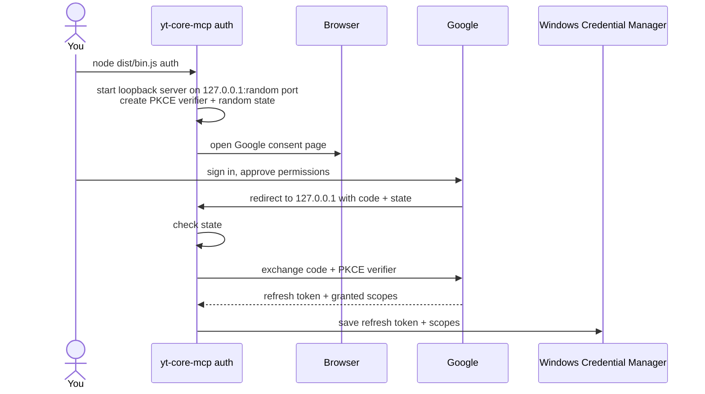
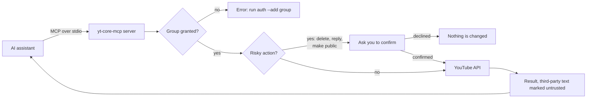

# yt-core-mcp

MCP server that lets an AI assistant (for example Claude) manage **your own YouTube channel**: schedule and publish live streams, edit videos, upload videos and captions, manage playlists, answer comments and read analytics. TypeScript, official Google APIs only, runs only on your computer.

Website: quick guide and docs in [`web/`](web/) (`quick-guide.html`, `docs.html`).

- [Features](#features)
- [Quick start](#quick-start)
- [Setup step by step](#setup-step-by-step)
- [CLI reference](#cli-reference)
- [Permission groups](#permission-groups)
- [Configuration](#configuration)
- [How it works](#how-it-works)
- [Security](#security)
- [Quota](#quota)
- [Troubleshooting](#troubleshooting)
- [Development](#development)

## Features

| Area | Tools | Permission group |
|---|---|---|
| Live streams | `live_schedule_broadcast`, `live_update_broadcast`, `live_publish_broadcast`, `live_list_broadcasts`, `live_get_broadcast`, `live_list_streams`, `live_delete_broadcast` | `core` |
| Videos | `video_get`, `video_list`, `video_update`, `video_set_thumbnail`, `video_upload`, `video_delete` | `core` |
| Playlists | `playlist_list`, `playlist_create`, `playlist_add_item`, `playlist_remove_item` | `core` |
| Channel & search | `channel_get`, `categories_list`, `videos_trending`, `search_public` | `core` |
| Captions | `caption_list`, `caption_upload` | `engagement` |
| Comments | `comment_list`, `comment_reply` | `engagement` |
| Analytics | `analytics_overview`, `analytics_top_videos`, `analytics_video`, `analytics_daily`, `analytics_traffic_sources`, `analytics_demographics`, `analytics_geography`, `analytics_retention` | `analytics` |
| Login info | `auth_status` | – |

Every tool description says which permission group it needs and how much quota it costs.

## Quick start

You need Node.js 26+ and a Google account that owns the channel.

```sh
npm ci && npm run build
node dist/bin.js auth                 # log in (opens the browser)
claude mcp add yt-core -- node D:/Projects/yt-core-mcp/dist/bin.js
```

Before this you need a Google OAuth client file — see [Setup step by step](#setup-step-by-step).

## Setup step by step

1. **Google Cloud project** (one time)
   - Create a project in [Google Cloud Console](https://console.cloud.google.com/).
   - *APIs & Services → Library*: enable **YouTube Data API v3** (and **YouTube Analytics API** if you want analytics).
   - *Google Auth Platform → Branding / Audience*: user type **External**, add the channel owner account as a test user.
     Then **Publish app → In production** — in *Testing* mode Google expires refresh tokens after 7 days.
   - *Clients → Create client → Application type: Desktop app*. Download the JSON.
2. **Client file**: save the JSON as `%APPDATA%\yt-core-mcp\client_secret.json`
   (macOS/Linux: `~/.config/yt-core-mcp/client_secret.json`), or set `YT_CORE_MCP_CLIENT_FILE` to its path.
3. **Build**: `npm ci && npm run build`
4. **Log in** in a terminal (never through the AI): `node dist/bin.js auth`
   - Add more permissions later, e.g. `node dist/bin.js auth --add analytics` or `--add all`.
5. **Register the server in your MCP client**
   - Claude Code: `claude mcp add yt-core -- node D:/Projects/yt-core-mcp/dist/bin.js`
   - Claude Desktop (`claude_desktop_config.json`):
     ```json
     {
       "mcpServers": {
         "yt-core": {
           "command": "node",
           "args": ["D:/Projects/yt-core-mcp/dist/bin.js"],
           "env": { "YT_CORE_MCP_MEDIA_ROOT": "D:/Media/YouTube" }
         }
       }
     }
     ```
6. **Local files** (optional — thumbnails, videos, captions): set `YT_CORE_MCP_MEDIA_ROOT` to the only folder the server may read. Not set ⇒ file uploads are off.
7. Ask your assistant: *"Check yt-core auth status"* — it should say you are logged in.

## CLI reference

Run with `node dist/bin.js <command>` (or `yt-core-mcp <command>` if installed as a bin).

| Command | What it does |
|---|---|
| *(no command)* | Starts the MCP server (stdio). Your MCP client runs this. |
| `auth` | Log in with the `core` permission (opens the browser). |
| `auth --add <group>` | Add a permission group: `engagement`, `analytics`. Keeps the groups you already have. |
| `auth --add all` | Add every permission group at once (optional — asks for the most access). |
| `auth --status` | Show the client file path and granted groups. |
| `auth --logout` | Revoke the token at Google and delete it from this computer. |
| `auth --help` | Show help. |

`--add` can be repeated. `captions` and `comments` are accepted as older names for `engagement`.

## Permission groups

| Group | Google scope | Used for |
|---|---|---|
| `core` (always) | `youtube` | live streams, videos, uploads, thumbnails, playlists, channel, search |
| `engagement` | `youtube.force-ssl` | captions and comments |
| `analytics` | `yt-analytics.readonly` | YouTube Analytics reports (read only) |

- Only `core` is asked for at first login. Other groups are added only when you run `auth --add` (incremental authorization).
- On Google's consent screen you can untick a permission. The app stores only what you really granted and tells you what is missing.
- If a tool needs a group you don't have, it fails with the exact command to run, e.g. ``Permission "analytics" not granted. Run `yt-core-mcp auth --add analytics` in a terminal.``

## Configuration

All settings are environment variables. Set them in your MCP client config (`env`) or in the shell.

| Variable | Default | Meaning |
|---|---|---|
| `YT_CORE_MCP_CLIENT_FILE` | `%APPDATA%\yt-core-mcp\client_secret.json` | Path to the Google OAuth "Desktop app" client JSON. |
| `YT_CORE_MCP_MEDIA_ROOT` | *(not set ⇒ uploads off)* | The only folder the server may read files from. |
| `YT_CORE_MCP_TIMEZONE` | `Europe/Bratislava` | Default IANA time zone for live stream start times. |
| `YT_CORE_MCP_REGION` | `SK` | Default 2-letter region for trending videos and video categories. |

`auth_status` shows the resolved values.

## How it works

### Login (terminal only)



### A tool call



- The server reads the refresh token from the vault and keeps **one** OAuth client in memory, so access tokens are reused between calls. It is rebuilt after login, logout or `--add`.
- If Google rotates the refresh token, the new one is saved back to the vault. A failed save is logged to stderr and never crashes the server.

## Security

- **OAuth 2.0 for installed apps** (RFC 8252): authorization code + **PKCE S256** + random `state` (constant-time check), loopback redirect on **127.0.0.1 only**, random port, 5-minute timeout, no request data reflected into HTML.
- **Login is CLI-only** — the MCP server cannot start a login, add permissions or see tokens.
- **Least privilege**: only the `youtube` scope by default; `engagement` and `analytics` added only on request.
- **Token storage**: refresh token in the OS vault (Windows Credential Manager / macOS Keychain / Secret Service via `@napi-rs/keyring`); access tokens only in memory. Logout revokes the token at Google.
- **Confirmations** (MCP elicitation) before risky actions: deleting videos, broadcasts or playlist items, posting a comment reply, publishing a broadcast, and making anything public or unlisted (`video_update`, `video_upload`, `playlist_create`, `live_schedule_broadcast`). Clients without elicitation support get a refusal, never a silent change.
- **Untrusted content**: titles, descriptions, comments and other third-party text are wrapped with a notice so the model treats them as data, not instructions (prompt-injection defence).
- **Local file guard**: one allowed folder; realpath containment (no `..`, symlink, junction, hard link or UNC escape), regular files only, size limits (thumbnail JPEG/PNG 2 MB, video MP4/MOV/MKV/WebM 256 GB, caption SRT/VTT 100 MB), magic-byte type check, read only from the checked handle, same refusal message for every case.
- **MCP**: stdio transport only, all logs to stderr, tool annotations (`readOnlyHint`, `destructiveHint`), validated inputs (zod).
- **Supply chain**: exact versions + `package-lock.json`, `ignore-scripts=true`, dependencies installed with a 14-day release cooldown, `npm audit` clean for production deps.
  Known dev-only finding: `minimatch` (moderate ReDoS) inside ESLint — not exploitable here (only our own glob config), no compatible fix yet.

You can remove the app's access any time in your [Google account permissions](https://myaccount.google.com/permissions).

## Quota

The YouTube Data API gives each Cloud project **10,000 units per day** by default. Most reads cost 1 unit, most writes 50.

- `video_upload` and `search_public` have their **own** daily limits (100 calls per day each by default), separate from the 10,000 units.
- Analytics tools use the YouTube Analytics API quota, not YouTube Data API units.
- Exact costs are in each tool's description. Sources: [quota costs](https://developers.google.com/youtube/v3/determine_quota_cost), [revision history](https://developers.google.com/youtube/v3/revision_history). Your real limits are on the Cloud Console *Quotas* page.

## Troubleshooting

| Problem | Fix |
|---|---|
| `Not logged in` | Run `node dist/bin.js auth`. |
| `Permission "<group>" not granted` | Run `node dist/bin.js auth --add <group>` (or `--add all`), then reconnect the MCP server. |
| `Login expired or was revoked` / `invalid_grant` | Run `node dist/bin.js auth` again. If it happens every 7 days, publish the app *In production* (see Setup step 1). |
| `OAuth client file not found` | Save the client JSON to the default path or set `YT_CORE_MCP_CLIENT_FILE`. |
| `...the MCP client does not support elicitation. Refused.` | Your MCP client can't show confirmations; use a client that supports elicitation (e.g. Claude Code). |
| Uploaded videos stay private | Uploads from unverified API projects are locked to private until the project passes a YouTube audit. |
| File upload refused | Set `YT_CORE_MCP_MEDIA_ROOT` and put the file inside that folder (no links/shortcuts). |
| New tools/inputs don't show up | Run `npm run build` and reconnect the server (`/mcp` in Claude Code). |

## Development

```sh
npm run lint
npm run typecheck
npm test
npm run build
```

The website (`web/`) is plain HTML + CSS, deployed on Vercel (`cleanUrls`). Preview it locally with `npx serve web`.
